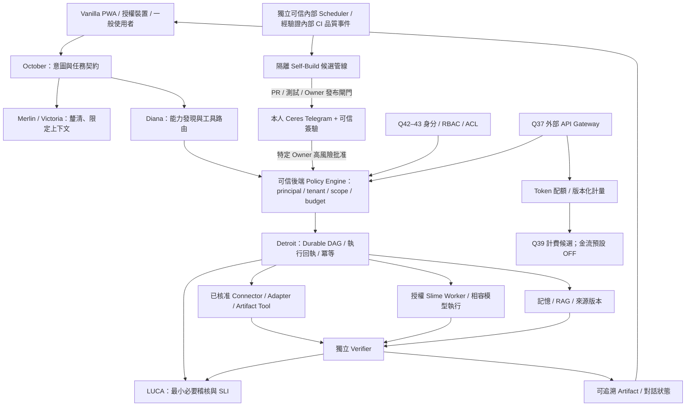

# October（阿土伯）｜Q50 可交付架構與驗收路線圖

> **決策狀態**：Q01–Q23、Q25–Q50 已由 Owner 確認，共 49 題；**Q24 略過且不得自動補選**。此文件是 Q50 D 的工程執行藍圖，不是已完成產品證明。
>
> **檢視基準**：2026-10-21，`easylearnfromtw/vanilla` 分支 `feat/signwell-agent-sandbox-20261020`。本次僅透過 GitHub 讀取程式／檔案清單與已有文件，**沒有在真實設備、正式網域、Railway、Cloudflare、GPU、Telegram 或 CI Runner 執行端對端驗收**。連結：[50 題決策](DECISIONS_50.md)｜[逐題追蹤](REQUIREMENTS_TRACEABILITY.md)｜[可執行 Backlog](IMPLEMENTATION_BACKLOG.md)。

## 1. 完成定義與證據等級

每個 `REQ-Qnn` 應填寫 `decision=confirmed|skipped`、`implementation=not_started|partial|implemented`、`verification=not_run|failed|passed`、`deployment=not_deployed|staging|production`、`evidence_refs`、`source_revision`、`owner`、`next_action`。

- **規格已確認**：使用者選擇記入 `DECISIONS_50.md`，不代表已寫程式。
- **程式／基礎設施存在**：檔案、腳本或服務端點存在；僅代表存在，未證明已設定、正確或安全。
- **已通過測試**：測試命令、環境、日期、固定 commit、exit code、報告及驗證範圍均可追溯；歷史測試及 synthetic accuracy 不能代表新 commit 或真實服務通過。
- **已部署且驗收**：部署 URL／build digest、部署紀錄、真實授權動作回執、裝置驗收及回滾演練都有證據；僅有 GitHub Pages build 綠燈不代表多服務全部正式上線。
- **未知** 不是通過；當前 branch 未實際執行／讀取部署狀態時維持 `not_run`／`unverified`。

本路線圖的交付順序是**候選分階段安排**，以依賴、風險與成本調整；不是承諾日期、價格或已完成里程碑。

## 2. 本次 GitHub 只讀盤點：證據與限制

| 層面 | 已見到的證據 | 目前不可以推論 |
|---|---|---|
| Vanilla 前端 | `README.md`：React + Vite PWA、WebLLM／Ollama／可授權雲端模型；`src/` 含 `local-ai`、`detroit`、`ceres`、`slime`、`luca` 等目錄；`package.json` 有建置及多個測試腳本 | October 全自主運作、所有模組可用、iPhone 端到端正常 |
| October 專屬 | `training/october/README.md`、`Modelfile`、`Modelfile.lite`、`policy.mjs`、`policy.test.mjs`、`train_policy.py`、`.github/workflows/october-policy-training.yml` | 完整 Qwen 微調完成、所有任務可執行、正式可收費 |
| 模擬策略 | `policy.mjs` 明文傳回 `SIMULATED_RECOMMENDATION` 且 `authorizedToExecute:false`；`README` 說 policy head 為合成場景監督訓練，且 Detroit scoped runtime 是待整合目標 | 模擬分類結果能當成後端執行授權／正式決策正確率 |
| Detroit／背景任務 | `docs/DETROIT_ARCHITECTURE.md` 說明現有模組與可部署參考 Worker；`services/detroit-jobs`、`tests/detroit*.test.mjs` 存在 | 已有通用、多租戶、可恢復且在線的正式 Agent 工作佇列 |
| Ceres | `docs/CERES_TELEGRAM_ADMIN.md` 有 Owner 後端管理設計及部分管理路由；明示更多高風險寫入型操作尚未全部遷入 | 所有管理功能已經只由 Telegram 安全執行或全部驗證 |
| Slime | `docs/SLIME_DISTRIBUTED_NODES.md` 將節點登錄／心跳定位為 MVP，候選路由 `executed:false`；`services/slime`／`services/weiguo` 存在 | 多機協同 30B、可用 GPU 推論或朋友遠端派工已正式工作 |
| 既有測試與發布 | `package.json`、`.github/workflows/ci.yml`、`docs/DETROIT_CORE_RELEASE_GATE.md` 定義迴歸／建置；`docs/GO_LIVE_AUDIT.md` 記有 2026-10-19 的歷史前端部署查核 | Q50 這次分支的全部測試已通過、正式多服務發布已完成 |

**盤點結論**：這是一個已有 React PWA、部分 AI／工具／授權元件、試驗型 October 策略及測試基礎的 repository。Q50 應先建立真實執行垂直切片與權限閘門，而非一口氣把 49 項規格標成上線。部署實況必須重新讀取當次 CI／環境回執才能更新。

## 3. 系統邊界與依賴圖

### 必須保持的非連線

- 一般聊天、語音、圖片、Slime 安裝器、資料匯入、外部 SDK/Plugin、用戶排程、任何 webhook、Agent 輸出**都不能直接或間接 enqueue Self-Build**；它只認得獨立可信後端排程／內部驗證品質事件。
- Ceres Owner 的 Telegram 數字 user/chat 身分、時效／nonce、action/version/resource 綁定在**後端**核驗；企業 SSO 管理員、付費訂閱、朋友 Worker、外部 API Key 不繼承 Owner。
- Q39 真實收費、Q30 正式發布、Q47 高風險更新、Q49 高風險資料恢復都要各自遵守更嚴格的 Owner＋服務端審批，不以先前某次廣義同意代替。
- Q24 **沒有定義**，任何組件不得偷偷假設其設計選擇已定。

## 4. 依賴優先順序與 MVP 邊界

### 必須先滿足的 P0 安全前置

身分與租戶關聯、最小權限 Policy Engine、真實工具回執、驗證器、祕密隔離、輸入不可信、可停止／撤銷、可靠建置與測試證據。先有 P0，後續才可打開跨裝置同步、持久排程、Slime、外部 API／第三方 SDK。這些安全要求**不是**選配，不能因效能低而繞過。

### MVP（候選 v0.4 core-sandbox）

- **包含**：October → Diana → Policy Engine → Detroit → Verifier → 對話／Artifact result 的一條可測垂直切片；一個真正授權的唯讀工具、拒絕／缺權限測試、誠實的工具執行紀錄、模型失敗／超時處理、最小任務狀態；在原有小模型／本機推論上先可運作。
- **可先用模擬、不宣稱正式可用**：跨企業 RBAC、付費收款、完整聲畫串流、30B 多機推論、所有開發者插件、完整 SSO／SCIM、跨供應商無損移轉、全部 Wordcraft 模組、真實長期 Agent 自動化。
- **不得出現在 MVP 發布宣稱**：已訓練出高性能 30B、已實際使用所有 Detroit 工具、已完成第三方支付、所有人皆可安裝、所有服務全年無間斷、正式法規認證。
- **入口 UX**：一般使用者說需求，不需選工具；呈現真實 running／partial／failed／verified，不顯示假百分比；管理操作只在 Ceres Owner 路徑，未受信 Ceres 不授予管理能力。

### 硬體與預算政策

使用者現有 RTX 3050 **桌機**（VRAM 須實測）、弱效 Windows、Raspberry Pi 4（散熱需確認），Mac mini 尚非已購設備。工程驗收先以現有設備與 CPU／小模型、測試替身完成，**新購硬體不是 P0–M1 的完成前提**。初期新增硬體／第三方支出規劃目標為 **NT$10,000 內**（此值是預算目標、不是市場報價或已批准付款）；任何需要購買 GPU／Mac、開通付費雲端或商業 SaaS 的項目先做成本／效益試算並取得 Owner 核准。多台低階模型的參數不可簡單相加宣稱達 30B，必須以實測模型、記憶體、網路瓶頸、tokens/s、品質與能耗評估。

## 5. 版本化里程碑（exit gates）

| Milestone | 優先 | 應交付的可驗證成果 | 主要依賴與退出門檻 |
|---|---|---|---|
| **M0 — Evidence & Trust Baseline** | P0 | 現有程式／服務能力盤點、追蹤矩陣、正式 Owner 信任根政策、CI 基線、金鑰掃描、可重現測試手冊 | 每個模組標 `not_run/partial/verified`；至少能在乾淨 checkout 跑指定 baseline；未通過則停 |
| **M1 — Trusted Agent MVP** | P0 | October→Diana→Detroit→Verifier 真正唯讀垂直切片、typed task schema、策略拒絕、execution receipt、真實結果 UI；安全停止 | 無 scope／跨租戶／不可信輸出必須阻擋；正常任務有真實回執，Verifier 獨立核對 |
| **M2 — Durable Context & Owner Control** | P0/P1 | 受信後端 Durable DAG、Checkpoint、RAG／記憶來源隔離、LUCA 最小必要稽核、Ceres Owner 操作閘門 | 重啟／撤權／重試無雙重副作用；Telegram callback 不能偽造 Owner，Self-Build 僅背景可信來源 |
| **M3 — Real-Device Nodes & Input** | P1 | RTX3050/Pi/Windows 能力實測、Slime 授權節點與 Worker 路由驗證、Retina 圖像來源真實解析、UI 效能分級 | 未授權節點不能收工作；視覺不可用不亂認；設備中斷時安全降級 |
| **M4 — Useful Artifacts & Connectors** | P1/P2 | PDF／表格／簡報等經實際產檔證實的成果、Scout/Notion 等授權 Connector、條件式個人自動化、專業分析證據鏈 | 端到端 Artifact 可打開；來源有驗證；未部署 Scheduler 不報告已排程 |
| **M5 — External Platform / Enterprise (Sandbox)** | P2 | API Gateway／Key Token 原子配額、Model Registry、SDK candidate sandbox、企業 workspace+ACL、SAML/OIDC/SCIM、Q39 billing sandbox | 各租戶隔離測試、配額競態、發票／付款 idempotency；**正式金流 OFF**，不能宣稱 SSO 及收款已上線 |
| **M6 — Release & Portability Hardening** | P2 | Installer／簽章更新／回滾、跨系統資料移轉 dry-run、跨裝置實測、故障注入、備份還原、SLO 報告及 release candidate | 真正驗證硬體與供應鏈；資料與 ACL 無擴權；Owner 核准合適的正式發布 digest |
| **M7 — Owner Production Gate** | P0 gate | 完整 release evidence bundle：code SHA、CI、E2E、裝置、權限、SRE、跨境與成本、未完成功能清單、Rollback Runbook | 只有本人透過受信 Ceres Telegram 明確批准指定 release／environment 後方可部署；未達門檻停在 candidate |

Milestone 先後是依賴預設：**M0→M1→M2→M3/M4→M5→M6→M7**。相互獨立的文件／UI 工作可平行，但不代表可提前繞過安全退出門檻。選擇 M7 之外的部分 MVP 公開發布，同樣必須依其功能風險符合對應的正式 Owner gate；不必等到所有 49 項功能都完成才開始測試。

## 6. 統一 Definition of Done（DoD）

每項 Feature PR／Epic 至少要：

1. **契約**：追蹤到 `REQ-Qnn`、使用者情境、依賴、風險、角色、資料流向、API/Tool schema、限制與非目標；Q24 不得成為功能前提。
2. **程式碼與最低證據**：固定 commit、可重現 build／lint/typecheck、適用的 unit／integration／negative security tests、測試輸出與 artifact refs。歷史 PR PASS 不代替本次 commit 的測試。
3. **權限、安全、資料**：Owner 不可偽造；tenant、workspace、resource ACL、credential handling、合規與資料外送、prompt injection、Self-Build 信任界線具 negative tests。
4. **真實性**：模型/工具聲稱的結果對應實際 provider/tool response、來源、操作結果、Verifier；unknown 保留 unknown，不臆測。
5. **效能、資源與成本**：報告實測設備、VRAM/RAM、latency/TTFT、錯誤率、tokens、成本及效能退化；沒有量測不可填 PASS。
6. **容錯、停用和復原**：取消、重試、checkpoint、撤權、斷網、重啟與 rollback 演練；副作用操作須 idempotency 和 provider receipt。
7. **部署前審查**：清楚聲明已上線範圍、Feature Flag／Kill Switch、變更摘要、已知限制、回滾計畫；高風險及正式發布必須 Owner Ceres 特定核准。
8. **可觀測性**：LUCA／其他受信 logs 對照核心 SLI，最小化內容、維持日誌 ACL／保留期限；不洩漏私密輸入或 Key。
9. **未通過處理**：任何缺失標示 `blocked` 或 `partial` 並建立 follow-up Backlog；不能寫 `implemented`、`verified`、`deployed` 直到有對應證據。

## 7. 交付與責任

- `DECISIONS_50.md` 是唯一的**使用者已確認決策**記錄；Q24 不補選。
- `REQUIREMENTS_TRACEABILITY.md` 是每題條款 → 實作階段 → 驗收回執的追蹤基準，尚未有資料時一律 `unverified`。
- `IMPLEMENTATION_BACKLOG.md` 是工程工作拆解與可執行命令，PR／Issue 建立前僅是 backlog 草案，不可假稱工單已存在。
- 建議第一個安全垂直切片從 **唯讀資料工具** 開始；外部帳號、金流、部署、刪除與網路多節點最後才逐一開啟。
- 階段報告格式：`milestone / baseline SHA / implementation status / test commands and evidence / blockers / risk / next gate / Owner approval status`；若沒有真實測試報告就以 `unverified` 記載。

最後提醒：此文件所述 `M0–M7` 是 **待執行工程計畫**，不是目前已完成的 Release Notes，也不表示模型完成訓練、硬體購入、定期任務建立或正式服務上線。
